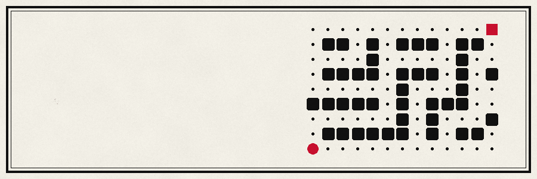

  

I turn messy data into things people can read: insurance fine print, campus records, market charts. Mostly Next.js, TypeScript and PostgreSQL, and I spend more time than is reasonable on the parts nobody sees: validation, read-only roles, sensible defaults.

I'd rather ship something small and sharp than something big and vague.

 

## Work

`released` means there's a live demo. `sealed` means source only.

 

Ask a campus database questions in plain English. Gemini drafts the SQL, a read-only role runs it, and charts come back. A what-if lab models things like attendance changes without touching a single record. &nbsp;·&nbsp; [source](https://github.com/cozyaar/datawise)

 

<!-- TODO: rewrite this line in your own words. I only know the repo says "Study Stock Website". -->
A website for studying the stock market, built to be learned from rather than refreshed. &nbsp;·&nbsp; [live](https://studystock.vercel.app) &nbsp;·&nbsp; [source](https://github.com/cozyaar/stock-study)

 

Health insurance without the sales pitch. It scores policies on a radar chart, flags the clauses insurers tuck away (room-rent caps, mandatory copays), and has a chat that suggests a fit for your situation. &nbsp;·&nbsp; [live](https://policylens-rouge.vercel.app) &nbsp;·&nbsp; [source](https://github.com/cozyaar/policylens)

 

<!-- TODO: fix the repo link here and below, and rewrite this line in your own words. -->
Pathfinding, made visible. &nbsp;·&nbsp; [source](https://github.com/cozyaar/pathfinder)

 

## Still sealed

Smaller things in the drawer:
[fig-and-flour](https://github.com/cozyaar/fig-and-flour) &middot;
[friendwithme](https://github.com/cozyaar/friendwithme) &middot;
[studentdashboard](https://github.com/cozyaar/studentdashboard) &middot;
[bakery-ordering-website](https://github.com/cozyaar/bakery-ordering-website) &middot;
[Institutional-Quality-Dashboard](https://github.com/cozyaar/Institutional-Quality-Dashboard)

 

<i>Every blade has a name. I'm still writing mine.</i>

