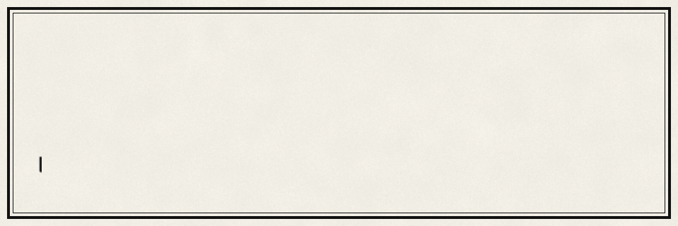
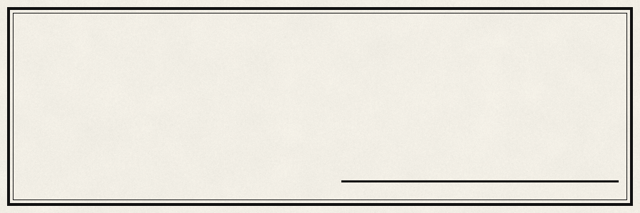
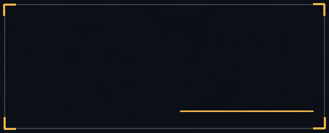
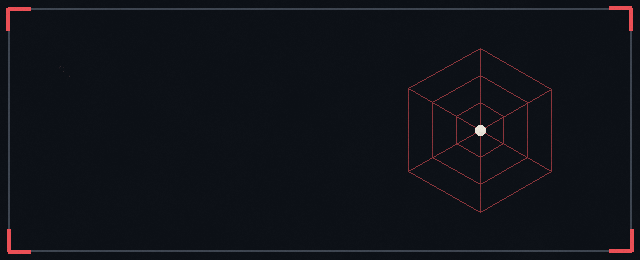
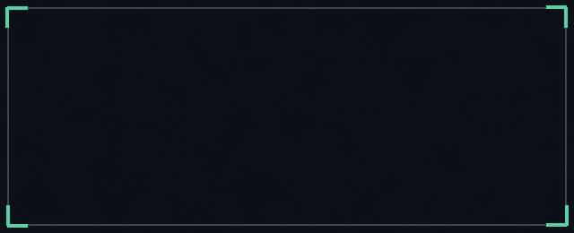
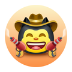

  

I'm **Kausthubh Prasad Nair**, also known as cozyaar. I turn messy data into things people can read: insurance fine print, campus records, market charts. Mostly Next.js, TypeScript, Python and PostgreSQL, and I spend more time than is reasonable on the parts nobody sees: validation, read-only roles, sensible defaults.

I'd rather ship something small and sharp than something big and vague.

 

Three of these four are **live right now**. Click a plate, or the green button under it, to open the real site.

  
  
  
  

**DataWise** &nbsp;·&nbsp; Ask a campus database questions in plain English. Gemini drafts the SQL, a read-only role runs it, and charts come back. A what-if lab models changes without touching a single record. 

<!-- TODO: rewrite the Study Stock line in your own words. The site's public text is empty, so I only know it's a stock market study site. -->
**Study Stock** &nbsp;·&nbsp; A website for studying the stock market, built to be learned from rather than refreshed. 
 

**PolicyLens** &nbsp;·&nbsp; An independent tool that scores Indian health insurance policies from 0 to 100 and flags the fine print: room-rent limits, co-pay clauses, sub-limits and waiting periods. It doesn't sell insurance. 
 

**Institutional Quality Dashboard** &nbsp;·&nbsp; Credential verification and skill-gap diagnosis mapped to NSQF and ISO/IEC 17024. Gemini reads resumes (PDF or image), scores the fit, draws a six-axis competency radar and writes a four-week roadmap. 
 

 

  

  
  
  
  

 

  
  &nbsp;
  
  &nbsp;
  
  &nbsp;
  

Pull Shark &nbsp;·&nbsp; YOLO &nbsp;·&nbsp; Quickdraw &nbsp;·&nbsp; Pair Extraordinaire

 

  

 

  <a href="https://github.com/cozyaar/fig-and-flour">fig-and-flour</a> &middot;
  <a href="https://github.com/cozyaar/friendwithme">friendwithme</a> &middot;
  <a href="https://github.com/cozyaar/studentdashboard">studentdashboard</a> &middot;
  <a href="https://github.com/cozyaar/bakery-ordering-website">bakery-ordering-website</a>

  

<i>Every blade has a name. I'm still writing mine.</i>

